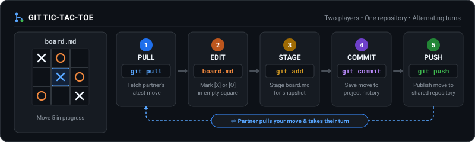

# Git Tic-Tac-Toe Template

You and a partner play tic-tac-toe in one shared GitHub repository. Each move is a small edit to the board, saved so your partner can review it.

## What you start with

This template ships with only the branch `main`.

`main` is the clean reference board. It contains `BOARD.txt`, an empty 3×3 grid of dots. Each row has three cells separated by one space. A move replaces one `.` with `X` or `O`.

Leave `main` untouched. Play only on the `match` branch, so the empty board stays available as the reference.

## Start the shared game

1. At the session, choose one person's public repository created from this template.
2. The owner invites the other partner as a collaborator.
3. On GitHub.com, before either person opens a Codespace, use the branch dropdown to create a branch named `match` from `main`.
4. Each partner then opens that same repository in a separate Codespace, on `match`. Both people use the browser editor.

Check the name in the lower-left corner. It must say `match` before you edit the board.

## Take a turn

Both partners work on `match`. Pull your partner's latest move before you edit.

1. In **Source Control**, select **Pull**.
2. Open `BOARD.txt`. Change one `.` to your mark (`X` or `O`), then save.
3. Look at the diff. It should show only that one mark.
4. Stage `BOARD.txt` with the **+** button.
5. Write a short commit message and select **Commit**.
6. Select **Push**. Tell your partner the move is ready.
7. Your partner pulls, checks the board, and takes the next turn.

Saving, staging, committing, and pushing are separate steps. Take turns.

## Rehearse before the workshop

Create your own public repository from this template. Open it in a Codespace, select **Ask** in Copilot Chat, and ask: “What does this repository do?” You are ready when the answer describes this shared tic-tac-toe game and says moves go in `BOARD.txt`. Leave the board unchanged, and keep the repository for the workshop.

At the session, follow **Start the shared game**: create `match` on GitHub.com before either person opens a Codespace.

## If you need help

Ask your partner or the facilitator to look at the board and Source Control with you.
